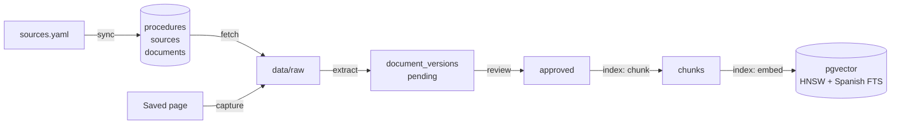

# Sin Vueltas

[](https://github.com/kenneth260298/sin-vueltas/actions/workflows/ci.yml)

The data layer of a RAG assistant for Costa Rican government procedures: it collects official pages and PDFs, keeps a reviewed version history, and turns approved text into a retrieval-ready index in PostgreSQL + pgvector.

🔗 [Landing page](https://kenneth260298.github.io/sin-vueltas/) · [English](https://kenneth260298.github.io/sin-vueltas/en/)

## Scope

This repository covers ingestion, human review, chunking and embeddings. Retrieval and answer generation are designed but out of scope; see [Future work](#future-work).

| | |
|---|---|
| Catalog | 21 procedures, 52 official sources, 37 crawlable documents |
| Index | 30 approved versions → 637 chunks |
| Embeddings | `text-embedding-3-small` at 768 dimensions, ~138k tokens (about $0.003 for the full corpus) |

## Architecture



| Command | What it does |
|---|---|
| `sync` | Loads the validated YAML catalog into `procedures`, `sources` and `documents`. |
| `fetch` | Downloads each document politely and stores a new version only when its extracted text changed. |
| `capture <url> <file>` | Records a page saved from a browser, for sites that reject bots. |
| `review list \| show \| approve \| reject` | Human review: diff a version against the approved one, then approve or reject it. |
| `index [--no-embed]` | Removes stale chunks, chunks newly approved versions and embeds what is missing. |

All commands run as `uv run python -m sin_vueltas.ingest <command>` and are idempotent: running them again never duplicates data or repeats paid work.

## Design decisions

- **Version by text, not bytes.** Pages embed dynamic tokens (ASP.NET ViewState, nonces), so hashing raw bytes produced false updates. Versions are keyed by a hash of the extracted text, with `UNIQUE (document_id, text_hash)`.
- **Human in the loop.** Every version starts as `pending`; nothing reaches the index until approved. A partial unique index guarantees at most one approved version per document.
- **Polite crawling.** robots.txt, an identifying User-Agent, 2 s per host and conditional requests (ETag / If-Modified-Since). Blocked sites are captured manually by a person; the crawler never disguises itself.
- **Two extraction modes.** `main` (trafilatura) for article-like pages, `full` (lxml without navigation chrome) for accordion pages. PDFs use pdfplumber (MIT), chosen over PyMuPDF (AGPL).
- **Section- and question-aware chunking.** Chunks follow Markdown headings and numbered FAQ questions, so a question stays with its answer. Table-of-contents lines and form leaders are dropped.
- **Contextual embeddings.** Each chunk is embedded with its procedure names and heading path prepended. The `embedding_model` column lets a model change re-embed only what it must.
- **One database for both retrievers.** `chunks.embedding` (HNSW, cosine) and `chunks.search_tsv` (GIN, Spanish full-text) live side by side, ready for hybrid search.
- **Safe by default.** Secrets come only from `.env` (`SecretStr`), and crawled content is treated as data, never as instructions.

## Getting started

Requirements: Python 3.12, [uv](https://docs.astral.sh/uv/) and Docker.

```bash
git clone https://github.com/kenneth260298/sin-vueltas.git
cd sin-vueltas
uv sync
docker compose up -d
cp .env.example .env            # Windows: copy .env.example .env, then set OPENAI_API_KEY
uv run alembic upgrade head

uv run python -m sin_vueltas.ingest sync
uv run python -m sin_vueltas.ingest fetch
uv run python -m sin_vueltas.ingest review list
uv run python -m sin_vueltas.ingest review approve <version ids>
uv run python -m sin_vueltas.ingest index
```

Run `index --no-embed` first to inspect the chunks without calling the embedding API.

## Tests and CI

```bash
uv run ruff check
uv run pytest
```

Database tests run inside a transaction that is rolled back, so they never touch your data; they are skipped locally when Postgres is not running. CI runs ruff, a migration upgrade/downgrade/upgrade roundtrip and the full test suite against Postgres with pgvector on every pull request.

## Project structure

```
data/sources.yaml          Source catalog (procedures and their official URLs)
migrations/                Alembic migrations 0001–0005
src/sin_vueltas/
  config.py                Settings from the environment / .env
  main.py                  FastAPI app (health check)
  ingest/
    catalog.py  sync.py    Catalog validation and database sync
    fetch.py  extract.py   Polite crawler and text extraction
    capture.py  review.py  Manual capture and human review
    chunk.py  embed.py  index.py   Chunking, embeddings and indexing
tests/                     Unit and database tests
docs/                      Landing page (GitHub Pages)
```

## Future work

The schema already holds both search indexes, so the next steps need no migrations:

1. Hybrid retrieval (vector + Spanish full-text, fused with RRF) behind a `/search` endpoint.
2. Profile-aware requirements (salaried, self-employed, retired, minor) extracted with an LLM and reviewed by a person.
3. A LangGraph agent that answers with verified citations and guardrails.
4. A 40-question golden set evaluated with MLflow on Databricks.
5. Deployment on Azure Container Apps with Neon, plus a weekly crawl job.

## Disclaimer

Sin Vueltas is an independent project, not affiliated with the TSE, CCSS, BCR, Ministerio de Hacienda or any other institution. Official requirements are always at the cited source.

## License

See [LICENSE](LICENSE).