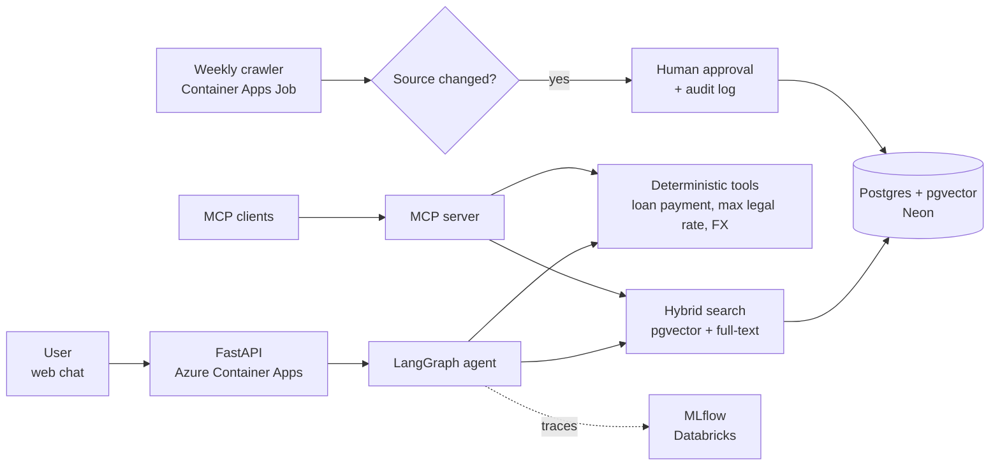

# Sin Vueltas


**An AI assistant that answers questions about everyday procedures in Costa Rica (driver's license, passport, loans, social security) with answers tailored to your situation and every requirement cited to its official source.**

## The problem

The information people need for everyday procedures is public, but it is scattered across dozens of official websites and PDFs. And the answer often depends on who is asking: applying for a loan as a salaried employee requires different documents than applying as a self-employed worker. Most people find out at the counter.

## What it does

You ask a question in plain Spanish, for example *"¿Qué necesito para pedir un préstamo?"*. Before answering, the assistant asks what changes the answer (salaried, self-employed or retired?). Then it returns:

1. A step-by-step checklist tailored to your profile.
2. Every requirement cited to the official source it came from, with the date it was last verified.
3. Exact calculations where they matter, such as a loan's monthly payment or whether an interest rate is above the legal maximum.
4. The order in which related procedures must be done.

If the official sources cannot back an answer, it says so and points you to the right institution.

## Engineering highlights

| Area | Approach |
| --- | --- |
| **Profile first** | The agent detects missing information and asks before answering, instead of guessing |
| **Deterministic tools** | Calculations run in code, not in the model: loan payments, legal maximum interest rates, exchange rates |
| **Fresh data with human approval** | A weekly crawler detects changes in official sources. The agent summarizes each change and pauses until a human approves it. Every approval is audited |
| **Hybrid retrieval** | pgvector similarity search plus Postgres full-text search in Spanish, fused with Reciprocal Rank Fusion |
| **MCP server** | The same tools are exposed through the Model Context Protocol, so any MCP client can use them |
| **Evaluation** | A golden set of real questions with known answers, run in CI on every pull request |
| **Security** | Only allowlisted official domains are crawled, and crawled content is treated as data, never as instructions. The public bot uses a read-only database role. No personal data is stored |
| **Cost guardrails** | Scale-to-zero hosting, daily query caps, response caching and a budget kill switch |

## Architecture (planned)



## Tech stack

| Layer | Technology |
| --- | --- |
| Language and API | Python 3.12, FastAPI, Pydantic, uv |
| Ingestion | httpx, trafilatura, PyMuPDF, pdfplumber |
| Database | PostgreSQL with pgvector (Neon in production, Docker locally) |
| Agent | LangGraph with a Postgres checkpointer |
| Tools protocol | Model Context Protocol (official Python SDK) |
| Evaluation and tracing | pytest, MLflow on Databricks |
| Hosting | Azure Container Apps and Container Apps Jobs |
| Secrets | Azure Key Vault with managed identity |
| CI/CD | GitHub Actions with OIDC (no stored cloud credentials) |
| Web | React, TypeScript, Vite |

## Getting started

Requirements: [uv](https://docs.astral.sh/uv/) and Docker.

```bash
git clone https://github.com/kenneth260298/sin-vueltas.git
cd sin-vueltas

cp .env.example .env          # Windows CMD: copy .env.example .env
docker compose up -d
docker compose exec db psql -U app -d sinvueltas -c "CREATE EXTENSION IF NOT EXISTS vector;"

uv sync
uv run uvicorn sin_vueltas.main:app --reload    # http://localhost:8000/docs
```

Run the checks:

```bash
uv run pytest
uv run ruff check .
uv run ruff format --check .
```

## Project structure

```
sin-vueltas/
├── src/sin_vueltas/
│   ├── main.py        # API
│   ├── config.py      # settings loaded from .env
│   ├── ingest/        # download and extract official sources
│   └── db/            # database access
├── tests/
├── data/              # list of procedures and their official sources
├── docker-compose.yml # local Postgres with pgvector
└── .github/workflows/ # CI
```

## Principles

- **Official sources only.** Every requirement links to its source and shows when it was last verified.
- **Information, not advice.** The assistant explains requirements and does the math. It does not give legal or financial advice and does not recommend banks or products.
- **No personal data.** It never asks for or stores ID numbers or other personal information.

## En español

Sin Vueltas es un asistente que responde preguntas sobre trámites en Costa Rica, como licencia, pasaporte, préstamos o la CCSS. Primero pregunta lo que cambia la respuesta (por ejemplo, si eres asalariado o independiente) y luego te da una lista de pasos a tu medida. Cada requisito va citado a su fuente oficial, con la fecha en que se verificó.

No es un sitio del gobierno ni da asesoría legal o financiera. Confirma siempre con la institución correspondiente.

## License

MIT. See [LICENSE](LICENSE).